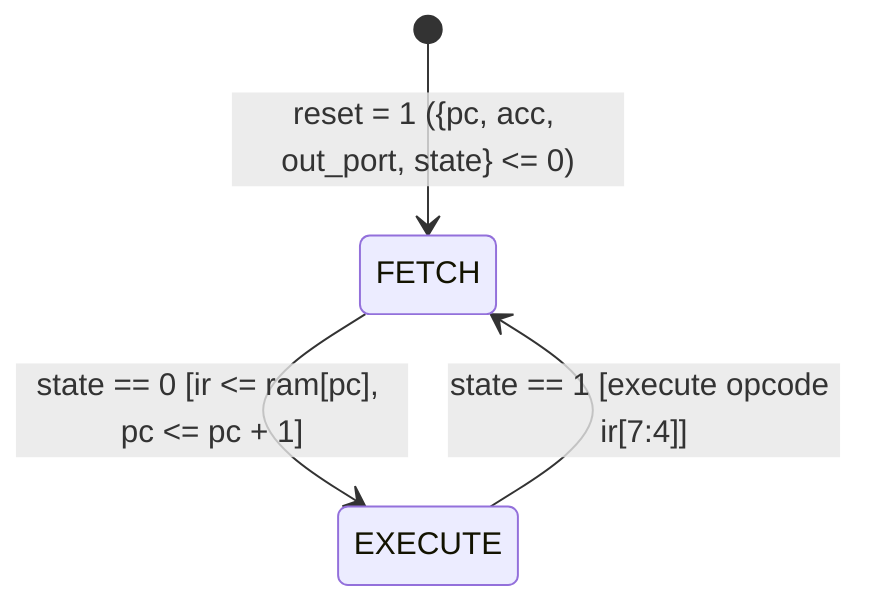
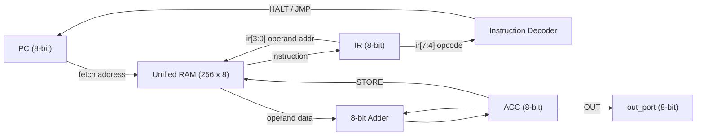

# Optimized 8-Bit Accumulator Microprocessor (Verilog)

A compact, cycle-efficient **8-bit von Neumann microprocessor** written in **19 lines of synthesizable-style Verilog**, paired with a **zero-`LOAD` ping-pong Fibonacci program** and self-checking simulation testbench.

Verified with **Icarus Verilog (`iverilog` / `vvp`)**, the processor computes and outputs every unsigned 8-bit Fibonacci number (`0, 1, 1, 2, 3, 5, 8, 13, 21, 34, 55, 89, 144, 233`) in **960 ns** at a `100 MHz` simulation clock.

---

## Repository Structure

```text
Optimized/
├── cpu.v                          # 8-bit 2-cycle microprocessor RTL (19 lines)
├── program.mem                    # Hex machine-code program & initial RAM values (9 lines)
├── testbench.v                    # 100 MHz clock/reset stimulus & decimal OUT logger (12 lines)
├── .gitignore                     # Ignores local build binaries while preserving reference outputs
├── README.md                      # Architecture, ISA, program trace, and simulation guide
├── docs/
│   └── optimization_comparison.md # Detailed comparison: Original vs Modified vs Optimized
├── scripts/
│   ├── run_sim.ps1                # One-command build & run script (Windows PowerShell)
│   └── run_sim.sh                 # One-command build & run script (Linux / macOS)
└── sim/
    ├── simulation_output.txt      # Verified console output from Icarus Verilog
    └── dump.vcd                   # Verified VCD waveform dump for GTKWave inspection
```

---

## Processor Architecture

### Ports & Internal Registers

| Signal | Width | Direction / Type | Description |
|---|---|---|---|
| `clk` | 1-bit | `input` | Rising-edge system clock (`10 ns` period / `100 MHz` in testbench) |
| `reset` | 1-bit | `input` | Asynchronous active-high reset (`posedge reset`) |
| `out_port` | 8-bit | `output reg` | Latched output port updated by the `OUT` instruction |
| `pc` | 8-bit | `reg` | **Program Counter** — address of next instruction in `ram` |
| `acc` | 8-bit | `reg` | **Accumulator** — primary arithmetic and data-transfer register |
| `ir` | 8-bit | `reg` | **Instruction Register** — holds fetched instruction byte during `EXECUTE` |
| `state` | 1-bit | `reg` | Two-cycle FSM state: `0` = `FETCH`, `1` = `EXECUTE` |
| `ram[0:255]` | 256 × 8 | `reg` array | Unified instruction and data memory loaded from `program.mem` |

### Two-Cycle Control FSM

Each instruction executes in **2 clock cycles (`20 ns`)** by toggling the 1-bit `state` register (`state <= ~state`) on every rising clock edge:



### Datapath Diagram



---

## Instruction Set Architecture (ISA)

Instructions are 8 bits wide: a **4-bit opcode** (`ir[7:4]`) followed by a **4-bit direct RAM address** (`ir[3:0]`, addressing `0x0`–`0xF`).

```text
  Bit:   7   6   5   4 | 3   2   1   0
       +---------------+---------------+
       |    Opcode     | 4-bit Address |
       +---------------+---------------+
```

| Opcode (`ir[7:4]`) | Mnemonic | RTL Action | Description |
|---|---|---|---|
| `4'h1` (`1`) | `LOAD addr` | `acc <= ram[ir[3:0]]` | Load byte from `ram[addr]` into `acc` |
| `4'h2` (`2`) | `ADD addr` | `acc <= acc + ram[ir[3:0]]` | Unsigned 8-bit addition into `acc` |
| `4'h3` (`3`) | `OUT` | `out_port <= acc` | Latch current `acc` value onto `out_port` |
| `4'h4` (`4`) | `HALT` | `pc <= pc - 1` | Rewind `pc` to repeat `HALT` indefinitely |
| `4'h5` (`5`) | `STORE addr` | `ram[ir[3:0]] <= acc` | Store current `acc` byte into `ram[addr]` |
| `4'h6` (`6`) | `JMP addr` | `pc <= ir[3:0]` | Unconditional jump to zero-extended `addr` |

---

## Optimized Fibonacci Program (`program.mem`)

Instead of maintaining three variables (`a`, `b`, `temp`) and reloading `acc` three times per iteration, `program.mem` exploits the fact that **`acc` already holds the newest Fibonacci sum** and alternates in-place updates across two RAM locations (`X` at `0x7` and `Y` at `0x8`).

### Memory Map

| Address | Hex | Assembly | Operation |
|---|---|---|---|
| `0x0` | `30` | `OUT` | Output current `acc` = $F(n)$ |
| `0x1` | `28` | `ADD 8` | `acc = acc + Y` = $F(n+1)$ |
| `0x2` | `58` | `STORE 8` | `Y = F(n+1)` |
| `0x3` | `30` | `OUT` | Output current `acc` = $F(n+1)$ |
| `0x4` | `27` | `ADD 7` | `acc = acc + X` = $F(n+2)$ |
| `0x5` | `57` | `STORE 7` | `X = F(n+2)` |
| `0x6` | `60` | `JMP 0` | Jump back to `0x0` |
| `0x7` | `00` | Data `X` | Initial value `0` |
| `0x8` | `01` | Data `Y` | Initial value `1` |

### Key Algorithmic & RTL Optimizations

- **Zero `LOAD` Instructions & No `temp` Variable:** Cuts loop size to 7 instructions while emitting **2 Fibonacci numbers per pass** (`3.5` instructions / `70 ns` per output vs `9` instructions / `180 ns` in a standard 3-variable loop — **2.57× faster**).
- **57% Fewer Total Lines of Code:** `cpu.v` (19 lines), `program.mem` (9 lines), and `testbench.v` (12 lines) total **40 lines** while remaining 100% cycle-for-cycle hardware-compatible with the uncompacted 6-opcode design.
- **Exact Pre-Overflow Termination & Duplicate-Safe Logging:** `testbench.v` logs every executed `OUT` instruction synchronously in decimal (capturing both `1`s in `0, 1, 1, 2...`) and stops at `960 ns` right after `233` ($F_{13}$), the largest Fibonacci value representable in 8 unsigned bits.

See [docs/optimization_comparison.md](docs/optimization_comparison.md) for the full stage-by-stage breakdown against the `Original` and `Modified` designs.

---

## Verified Simulation Output

```text
Time: 35 | OUT: 0
Time: 95 | OUT: 1
Time: 175 | OUT: 1
Time: 235 | OUT: 2
Time: 315 | OUT: 3
Time: 375 | OUT: 5
Time: 455 | OUT: 8
Time: 515 | OUT: 13
Time: 595 | OUT: 21
Time: 655 | OUT: 34
Time: 735 | OUT: 55
Time: 795 | OUT: 89
Time: 875 | OUT: 144
Time: 935 | OUT: 233
testbench.v:10: $finish called at 960 (1s)
```

---

## How to Build, Simulate & View Waveforms

### Prerequisites
- [Icarus Verilog](https://bleyer.org/icarus/) (`iverilog` and `vvp`)
- [GTKWave](https://gtkwave.sourceforge.net/) *(optional, for viewing `.vcd` waveforms)*

### Option 1: Direct Commands
Run from inside this directory:
```powershell
iverilog -Wall -o cpu_sim testbench.v cpu.v
vvp cpu_sim
```

### Option 2: Helper Scripts
- **Windows (PowerShell):**
  ```powershell
  .\scripts\run_sim.ps1
  ```
- **Linux / macOS (Bash):**
  ```bash
  bash ./scripts/run_sim.sh
  ```

### Viewing Waveforms in GTKWave
Open either the freshly generated `dump.vcd` or the pre-recorded reference waveform in `sim/dump.vcd`:
```powershell
gtkwave sim/dump.vcd
```
